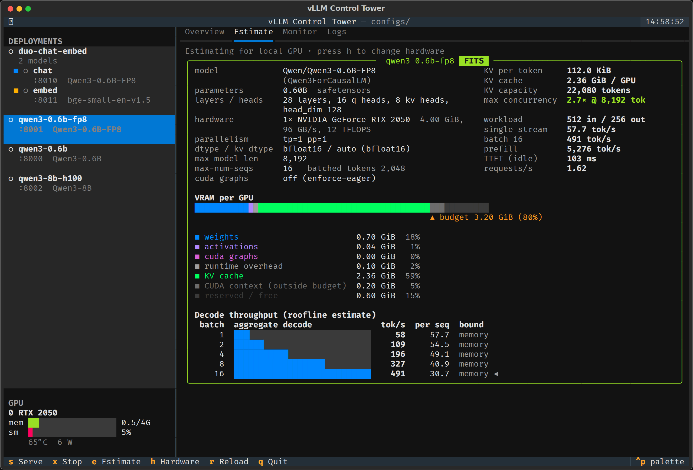
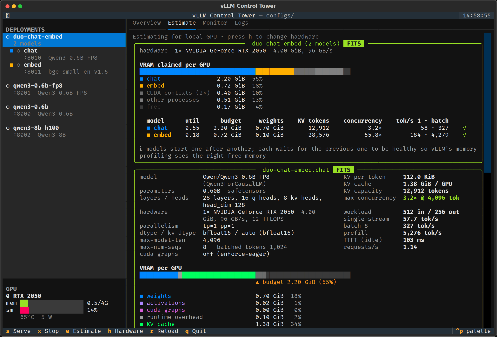

# vLLM Control Tower

A terminal control panel for [vLLM](https://github.com/vllm-project/vllm).

- Define deployments as YAML files in a `configs/` folder: one or more vLLM models served together.
- Browse them in a TUI with the arrow keys; serve, stop and monitor them live.
- Before you serve, estimate VRAM use, KV cache capacity and tokens/s on your GPU, or on any GPU from the spec table (H100, A100, L4, ...).



## Install

```bash
uv sync                  # the control tower itself
uv sync --extra vllm     # also install vLLM into the same venv (large download)
```

vLLM can also live elsewhere: set a model's `vllm.executable` to any `vllm` binary.
Executables named without a path are looked up first in this project's `.venv/bin`, then on `PATH`.

## Use

```bash
uv run vct                       # open the TUI
uv run vct list                  # deployments and their state
uv run vct estimate qwen3-0.6b   # memory / KV cache / throughput estimate on the local GPU
uv run vct estimate qwen3-8b-h100 --gpu H100          # ...or on hardware you don't have
uv run vct start qwen3-0.6b      # serve in the background, wait for /health
uv run vct status                # running servers + GPU usage
uv run vct logs qwen3-0.6b -f    # a multi-model deployment needs the model: duo-chat-embed.chat
uv run vct stop qwen3-0.6b       # or: vct stop --all
```

### TUI keys

| key | action |
| --- | --- |
| `↑` `↓` | select a deployment (or one model of a multi-model deployment) |
| `←` `→` / `1`–`4` | switch tab: Overview, Estimate, Monitor, Logs |
| `s` / `enter` | serve the selection; a deployment starts its models in order |
| `x` | stop it (asks for confirmation) |
| `h` | choose the GPU to estimate for |
| `r` | reload deployments from disk |
| `q` | quit (running servers keep running) |

## Deployment format

Every file is a deployment: a name, shared defaults and a `models:` list. A single model is a deployment with one entry.

```yaml
name: qwen3-0.6b               # defaults to the file name
description: Qwen3 0.6B on a 4 GB GPU
host: 127.0.0.1                # default for every model
env:                           # shared; a model's own env wins. ${VAR} and ${VAR:-default} are expanded
  HF_TOKEN: ${HF_TOKEN}
models:
  - name: main                 # optional: defaults to "main" (or m0, m1, ... when there are several)
    model: Qwen/Qwen3-0.6B     # HF repo id or local path
    port: 8000
    vllm:
      executable: vllm
      args:                    # any `vllm serve` option, with or without leading dashes
        gpu-memory-utilization: 0.8
        max-model-len: 4096
        max-num-seqs: 16
      flags: [enforce-eager]   # boolean switches
      extra_args: []           # passed through verbatim
    estimate:                  # workload assumed by the throughput estimate
      avg_prompt_tokens: 512
      avg_output_tokens: 256
```

Each model is one vLLM server, named `<deployment>.<model>` (e.g. `qwen3-0.6b.main`). That name is what you see in `vct status`, and it names the log file.

### Several models in one deployment

[configs/duo-chat-embed.yaml](configs/duo-chat-embed.yaml) serves a chat model and an embedding model on the same 4 GB GPU:

```yaml
name: duo-chat-embed
env: {HF_TOKEN: ${HF_TOKEN}}
models:
  - name: chat                    # duo-chat-embed.chat
    model: Qwen/Qwen3-0.6B-FP8
    port: 8010
    vllm: {args: {gpu-memory-utilization: 0.55, max-model-len: 4096}}
  - name: embed                   # duo-chat-embed.embed
    model: BAAI/bge-small-en-v1.5
    port: 8011
    vllm: {args: {runner: pooling, gpu-memory-utilization: 0.18, max-model-len: 512}}
```

- `vct start duo-chat-embed` starts models in the order listed. Each one starts only after the previous one passes its health check, because vLLM sizes its KV cache from the free memory it sees at startup.
- `vct stop duo-chat-embed` stops them in reverse order.
- `vct estimate duo-chat-embed` adds a combined check. Each vLLM instance claims `gpu-memory-utilization × total VRAM`, so models on the same GPU must sum to less than what is free, minus one CUDA context (~0.2 GiB) per model. Models with different `CUDA_VISIBLE_DEVICES` are budgeted separately.
- One model can be targeted on its own: `vct stop duo-chat-embed.embed`, `vct logs duo-chat-embed.chat -f`. In the TUI, multi-model deployments list their models underneath. The deployment row acts on all of them, and its Monitor and Logs tabs combine them.



Runtime state lives in `.vct/`: PID files, per-server logs (the previous run is kept as `.log.prev`), and cached model metadata. Override the locations with `VCT_CONFIG_DIR` and `VCT_RUNTIME_DIR`.

## How the estimate works

Model facts come from `config.json` and the safetensors headers. They are read from the local Hugging Face cache when available, otherwise fetched from the Hub (header bytes only, no weight download).

**Memory**, per GPU, follows how vLLM sizes its KV cache at startup:

```
budget   = total VRAM × gpu-memory-utilization
KV cache = budget − weights − activation peak − CUDA graphs − runtime overhead
KV bytes per token = 2 × layers × kv_heads/tp × head_dim × kv dtype size
```

The estimator handles GQA, MLA (DeepSeek), sliding-window layers, MoE, FP8 and pre-quantized checkpoints, and tensor and pipeline parallelism. It also warns when `gpu-memory-utilization` asks for more than is currently free. This check matters on desktops and WSL, where the display already holds some VRAM.

**Throughput** uses a roofline model. Each decode step reads the weights plus the batch's KV cache from memory, or is limited by compute, whichever is slower, plus a fixed scheduling overhead. The effective batch is the number of average requests whose KV fits in the cache, capped at `max-num-seqs`. Treat the results as ±30% and benchmark before you rely on them.

## Develop

```bash
uv run pytest            # tests/fake_vllm.py stands in for vLLM, so no GPU is needed
uv run ruff check src tests && uv run ruff format src tests
```
